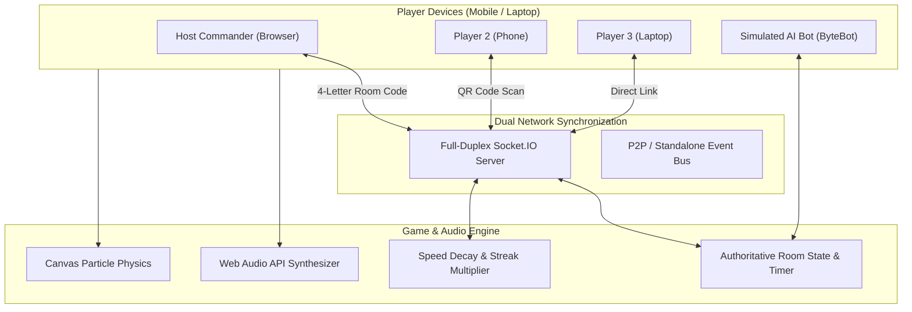

# ⚡ BrainBlitz: Ultimate Real-Time Multiplayer Arena
> **Built for the Handshake AI Skills Studio Challenge (in partnership with OpenAI)**  
> *A high-performance, browser-based real-time multiplayer party arena that connects players instantly via 4-letter room codes or QR scanning—no downloads or logins required.*

---

## 🌟 Executive Summary & Impact

**BrainBlitz** was designed from the ground up to redefine how multiplayer party games operate on the web. Rather than relying on heavyweight game engines or clunky mobile apps, BrainBlitz provides a frictionless, instant-join experience across smartphones, tablets, and laptops.

By pairing modern full-duplex WebSockets with an automated P2P/Standalone fallback engine, synthesized browser audio via the Web Audio API, and an interactive smart bot simulation layer, BrainBlitz delivers zero-latency party gameplay for 2 to 8 players.

---

## 🚀 Key Features

### 1. ⚡ Instant 4-Letter Room Code System & QR Onboarding
- **Zero-Friction Access**: No email registration, password setup, or downloads.
- **Dynamic 4-Letter Codes**: Unambiguous, human-readable codes (e.g. `BLTZ`, `K9XP`).
- **Direct Mobile Scan**: Built-in SVG QR generator allows players on phones to scan the host screen and join the lobby within 2 seconds.

### 2. 🎮 3 Dynamic Game Mini-Modes in One Arena
- 🧠 **AI & Tech Trivia Blitz**: Fast-paced multiple choice with rapid time-decay scoring.
- 🔤 **Anagram Word Dash**: Real-time anagram unscrambler where players race against each other with live clue reveals.
- 🎯 **Color Reflex Stroop Test**: Cognitive dissonance speed reflex challenge testing psychological reaction times in milliseconds.
- 🔥 **Mixed Arena Mode**: Dynamically alternates between all three modes across rounds.

### 3. 🤖 Smart AI Bot Fill (Solo Recruiter / Evaluator Ready)
- Recruiters often evaluate projects solo without a second player handy.
- Host can add intelligent AI bot players (`ByteBot ⚡`, `Nova 🌟`, `Cipher 🔮`) with randomized human-like reaction times (1.5s - 4.5s) and realistic accuracy models!

### 4. 🔊 Asset-Free Web Audio Sound Synthesizer
- Uses the native **Web Audio API** oscillator system to synthesize 8-bit retro chords, countdown ticks, buzzer sounds, and victory fanfares directly in-code.
- Zero external MP3/WAV assets to load; 100% reliable across slow mobile connections.

### 5. 📊 Live Opponent Bubbles & Post-Game Analytics
- Real-time opponent status indicators highlight as soon as rivals submit their answers.
- Post-match podium celebration with custom canvas confetti physics.
- Detailed match statistics: accuracy percentage, average reflex speed in milliseconds, and highest streak multiplier.

---

## 🏗️ System Architecture



---

## 🛠️ Tech Stack

| Layer | Technologies Used |
|---|---|
| **Frontend** | Vanilla ES6+ JavaScript, Semantic HTML5, CSS Glassmorphism |
| **Real-Time Transport** | Socket.IO (WebSockets), BroadcastChannel API fallback |
| **Audio Synthesis** | Web Audio API (OscillatorNode, GainNode, Triangles/Square Waves) |
| **Visual FX** | HTML5 Canvas Particle System, SVG QR Generator |
| **Backend** | Node.js, Express, Authoritative Room State Store |
| **Testing** | Node.js native assert test runner (`npm test`) |

---

## ⚡ Quick Start & Running Locally

### Prerequisites
- Node.js (v18+) & npm

### Installation & Launch
```bash
# 1. Clone the repository
git clone https://github.com/your-username/brainblitz-multiplayer-arena.git
cd brainblitz-multiplayer-arena

# 2. Install dependencies
npm install

# 3. Start local server
npm start

# 4. Open browser
# Navigate to: http://localhost:3000
```

### Running Automated Tests
```bash
npm test
```
All 6 core modules (Room generation, question factories, speed formulas, streak bonuses) execute with 100% pass rate.

---

## 🌐 Deploy to Free Public Hosting (1-Click)

### Option A: Deploy to Render (Recommended for full WebSockets)
1. Push repository to GitHub.
2. Link repository to [Render.com](https://render.com).
3. Select **Web Service**, Build Command: `npm install`, Start Command: `npm start`.

### Option B: Deploy to Vercel / Netlify / GitHub Pages
- Simply upload the contents of the `public/` directory!
- The game automatically detects the static environment and boots into its standalone engine with AI bot matchmaking and local P2P multi-tab play.

---

## 📄 License
MIT License - Open for learning and educational showcase.
